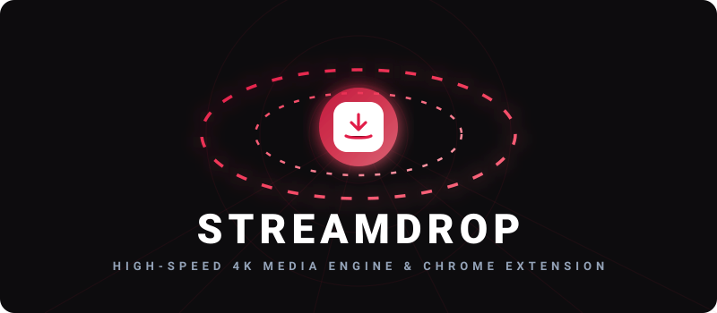

<p align="center">
  
</p>

<p align="center">
  
</p>

---

## 🚀 Key Features

*   **💎 Modern Rose-Red Aesthetic**: Designed with an ultra-clean, high-contrast dark theme and subtle glassmorphic glow effects.
*   **🧩 Chrome / Edge Extension (Manifest V3)**: Companion browser extension with YouTube DOM button injection, custom keyboard shortcut recorder, and in-popup quality selector.
*   **🌟 4K UHD & 1080p Stream Muxing**: Automatically extracts separate high-resolution DASH video & audio streams and merges them losslessly with FFmpeg (`--audio-quality 0`).
*   **⚡ Real-Time Progress Engine (SSE)**: Streams download progress, transfer speeds, and FFmpeg muxing states live via Server-Sent Events with sub-second latency.
*   **✂️ Video Trimming & Audio Extraction**: Clip precise sections (*start-end) and extract audiophile 320kbps MP3s.
*   **🔒 Security & Privacy-First**: Automated temp sweepers running every 10 minutes, rate limiting, and parameter validation.

---

## 📂 Project Structure

```
StreamDrop/
├── client/                 # React frontend (Vite environment)
│   ├── src/
│   │   ├── components/     # Layout buttons & modals
│   │   ├── context/        # ThemeContext controller
│   │   ├── pages/          # Downloader core rendering
│   │   └── index.css       # Light red palette & styles
│
├── server/                 # Express API backend
│   ├── src/
│   │   ├── config/         # Environment variable loaders
│   │   ├── middleware/     # Rate limiter & security hooks
│   │   ├── routes/         # Express endpoint maps
│   │   └── services/       # ytDlp wrappers & jobs controllers
│
├── extension/              # Chrome / Edge Browser Extension (Manifest V3)
│   ├── background.js       # Background service worker & downloads
│   ├── content.js          # In-page shortcut listener & DOM button injection
│   ├── popup.html/js/css   # Extension popup with quality selector
│   └── manifest.json       # Manifest V3 specification
│
├── shared/                 # Config constants shared between modules
└── tests/                  # Backend unit & integration test coverage
```

---

## 🛠️ Installation & Setup

### Prerequisites
1.  **Node.js** (v18.0.0 or higher)
2.  **FFmpeg** (registered in system environment PATH variables)
3.  **yt-dlp** (registered in system environment PATH variables)

### Launch Steps
1.  **Install dependencies**:
    ```bash
    npm run setup
    ```
2.  **Add Configuration**:
    Create a local environment file at `server/.env`:
    ```env
    PORT=5000
    NODE_ENV=development
    CLIENT_URL=http://localhost:5173
    DOWNLOAD_DIR=downloads/temp
    CLEANUP_INTERVAL_MS=300000
    FILE_LIFETIME_MS=600000
    RATE_LIMIT_MAX=100
    ```
3.  **Run Dev Servers**:
    ```bash
    npm run dev
    ```
    - Access Frontend at: [http://localhost:5173](http://localhost:5173)
    - Access Backend API at: [http://localhost:5000](http://localhost:5000)

---

## 📡 API Reference

| Endpoint | Method | Payload | Purpose |
| :--- | :--- | :--- | :--- |
| `/api/metadata` | `POST` | `{ "url": "..." }` | Extracts links, formats, and thumbnails |
| `/api/download/prepare` | `POST` | `{ "url": "...", "formatId": "...", "type": "video\|audio", "title": "..." }` | Registers a background download job |
| `/api/download/status/:jobId` | `GET` | *None* | Polls active download and merge progress |
| `/api/download/file/:jobId` | `GET` | *None* | Downloads completed file and triggers automated server cleanup |
| `/api/download/cancel/:jobId` | `POST` | *None* | Kills active processes and sweeps temporary chunks |


